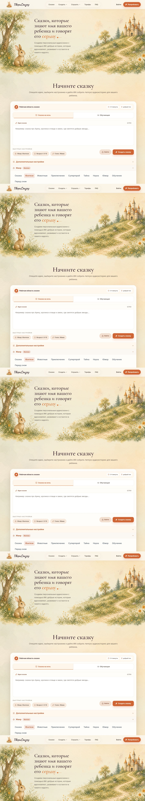
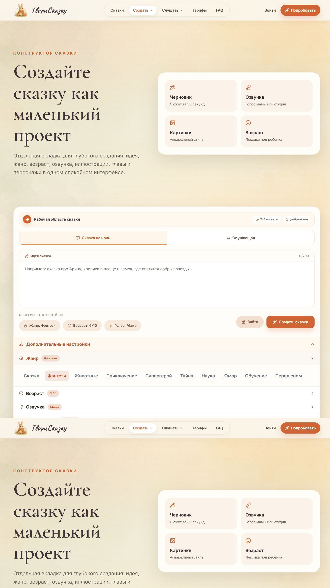
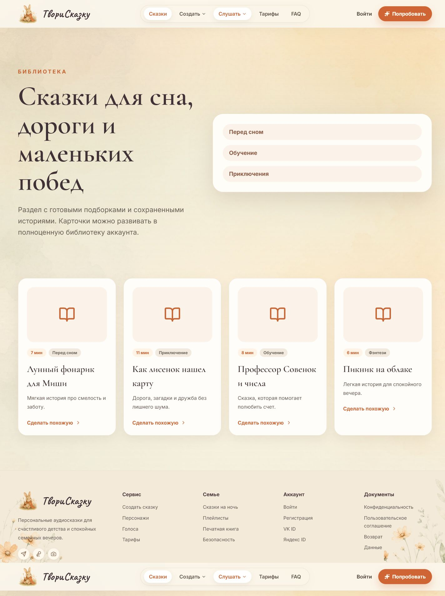

# ТвориСказку

**Сервис, который превращает родительскую идею в готовую персональную сказку с озвучкой, библиотекой и PDF-книгой.**

ТвориСказку помогает родителям быстро создать историю под конкретного ребёнка: выбрать возрастную группу, жанр, героя, настроение и голос рассказчика. На выходе получается не просто текст, а законченный семейный артефакт: сказку можно сохранить в библиотеку, озвучить, скачать как MP3 и оформить в PDF-книгу.

Проект сделан как полноценный end-to-end продукт, а не как одиночная форма генерации. В нём есть аккаунты, тарифы, библиотека сказок, профили детей, персонажи, генерация текста, озвучка, PDF, email-флоу, хранение файлов и отдельный TTS-relay для продакшен-схемы с двумя серверами.



## Почему это ценно

Родители часто хотят придумать ребёнку сказку “про него”, но на практике не хватает времени, сил и писательского навыка. ТвориСказку закрывает этот разрыв: пользователь вводит простую идею, а сервис собирает из неё аккуратную историю, которую можно сразу читать или слушать.

Продукт хорошо ложится на семейный сценарий: сказки на ночь, маленькие воспитательные истории, подарочные PDF-книги, персональные аудиосказки для дороги и повторного прослушивания. Это понятная аудитория, регулярное использование и естественный путь к подписке.

## Что уже работает

- Генерация персонализированных сказок по идее пользователя.
- Возрастные группы, жанры, темы, главы и настройки повествования.
- Готовые персонажи и визуальный конструктор героя.
- Библиотека сохранённых сказок.
- Озвучка готовыми голосами рассказчиков.
- Скачивание MP3.
- Подготовка PDF-книги.
- Регистрация, вход, подтверждение email и восстановление пароля.
- Тарифы и лимиты использования.
- Backend API, очередь генерации, хранение файлов и тестовое окружение.
- Отдельный stateless TTS-relay для подключения ElevenLabs через внешний сервер.

## Демо-флоу

1. Пользователь создаёт аккаунт или входит.
2. Вводит идею сказки.
3. Выбирает возрастную группу, жанр, героя и голос рассказчика.
4. Запускает генерацию.
5. Сохраняет сказку в библиотеку.
6. Создаёт озвучку и скачивает MP3.
7. При необходимости оформляет сказку как PDF-книгу.





## Архитектура

Проект разделён на независимые части:

- **Frontend:** React + Vite, страницы и компоненты пользовательского сценария.
- **Backend:** Fastify + TypeScript, модульная структура по доменам.
- **Database:** PostgreSQL + Prisma ORM.
- **Cache and queues:** Redis.
- **File storage:** MinIO, S3-совместимое хранилище.
- **PDF:** генерация книг на backend.
- **AI text:** Yandex Cloud AI Studio / DeepSeek.
- **TTS:** ElevenLabs через отдельный relay-сервер.
- **Infra:** Docker Compose для локальной инфраструктуры.
- **Tests:** Vitest для frontend и backend.

Код организован по продуктовым модулям: `auth`, `stories`, `tts`, `books`, `profiles`, `characters`, `tariffs`, `voice`, `illustrations`. Это помогает держать бизнес-логику отдельно от маршрутов, схем валидации и инфраструктурных адаптеров.

## Структура проекта

```text
.
├── src/                    # Frontend React-приложение
│   ├── components/          # Переиспользуемые UI-компоненты
│   ├── pages/               # Основные экраны продукта
│   └── lib/                 # Клиентские утилиты
├── backend/                 # Fastify API
│   ├── prisma/              # Prisma schema и миграции
│   └── src/
│       ├── config/          # Env и logger
│       ├── lib/             # Общие backend-утилиты
│       └── modules/         # Доменные модули
├── foreign-tts-relay/       # Отдельный relay для TTS
├── public/                  # Публичные ассеты
├── assets/                  # Исходные визуальные ассеты
└── screenshots/             # Скриншоты для презентации
```

## Локальный запуск

### 1. Установить зависимости

```bash
npm install
npm --prefix backend install
npm --prefix foreign-tts-relay install
```

### 2. Поднять инфраструктуру

```bash
docker compose up -d
```

После запуска будут доступны PostgreSQL, Redis, MinIO и Mailpit.

### 3. Подготовить backend

```bash
npm --prefix backend run prisma:generate
npm --prefix backend run prisma:migrate
```

### 4. Запустить backend

```bash
npm --prefix backend run dev
```

Backend API будет доступен на `http://127.0.0.1:3001`.

### 5. Запустить frontend

```bash
npm run dev
```

Frontend будет доступен на `http://127.0.0.1:3000`.

## Сервисы локального окружения

| Сервис | URL |
|---|---|
| Frontend | `http://127.0.0.1:3000` |
| Backend API | `http://127.0.0.1:3001` |
| Mailpit | `http://127.0.0.1:8025` |
| MinIO Console | `http://127.0.0.1:9001` |

## Переменные окружения

Используйте `.env.example` и `foreign-tts-relay/.env.example` как шаблоны.

Основные группы настроек:

- подключение к PostgreSQL, Redis и MinIO;
- ключ Yandex Cloud AI Studio;
- настройки ElevenLabs;
- настройки foreign TTS relay;
- домены frontend/backend;
- лимиты тарифов и генераций.

Реальные ключи должны храниться только в локальных `.env` файлах или в переменных окружения хостинга.

## Проверки

```bash
npm test
npm run build
npm --prefix backend run test
npm --prefix backend run build
```

Для relay-сервера:

```bash
npm --prefix foreign-tts-relay install
npm --prefix foreign-tts-relay run start
```

## Что показать в демо

- Главная страница с понятным позиционированием продукта.
- Регистрация с согласием родителя или законного представителя.
- Создание сказки из короткой идеи.
- Сохранение результата в библиотеку.
- Озвучка и скачивание MP3.
- PDF-книга как готовый результат, который можно отправить или распечатать.
- Аккаунт с тарифом и лимитами.

## Продуктовый потенциал

ТвориСказку можно развивать как семейную подписку: больше сказок в месяц, несколько детских профилей, расширенные голоса рассказчиков, коллекции тематических историй, подарочные PDF-книги и сезонные наборы сказок. Базовый сценарий уже собран так, чтобы его можно было показывать, тестировать на родителях и постепенно превращать в коммерческий продукт.
