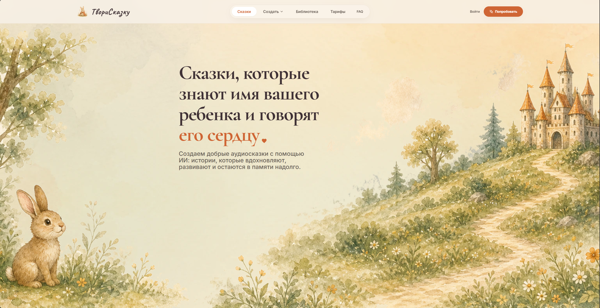
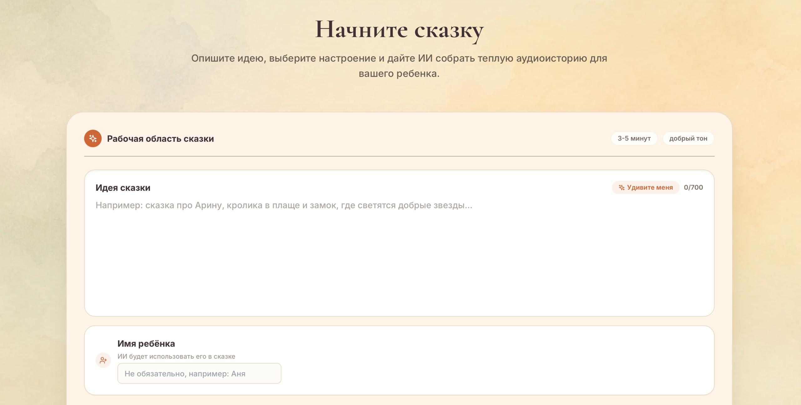
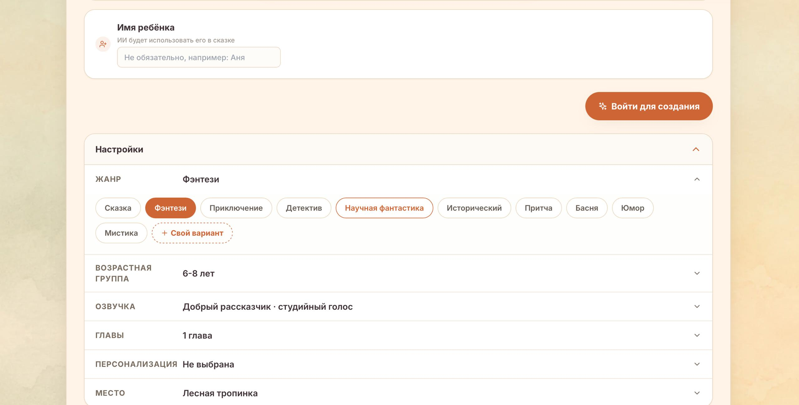
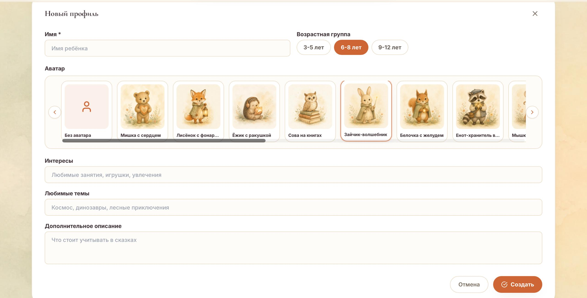
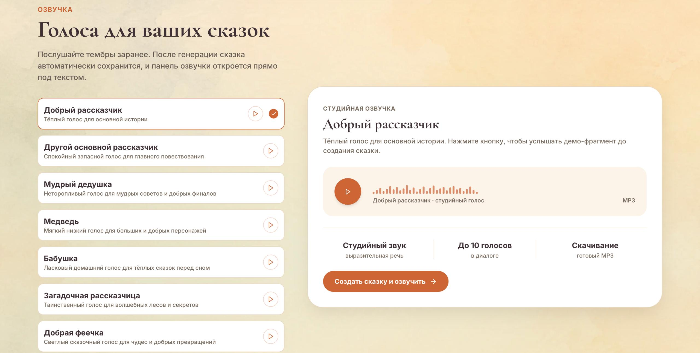
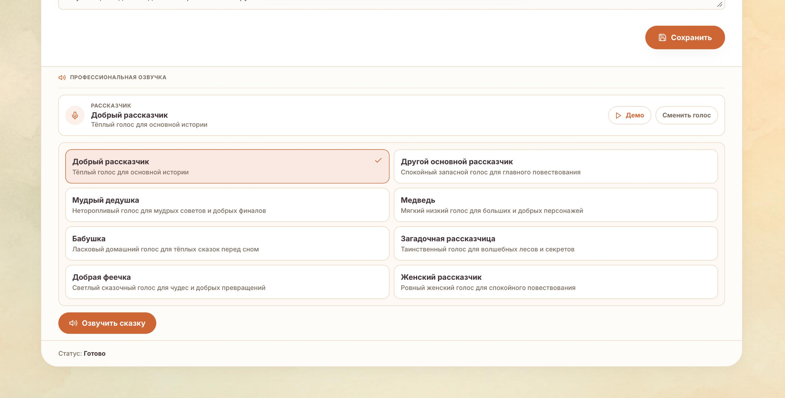
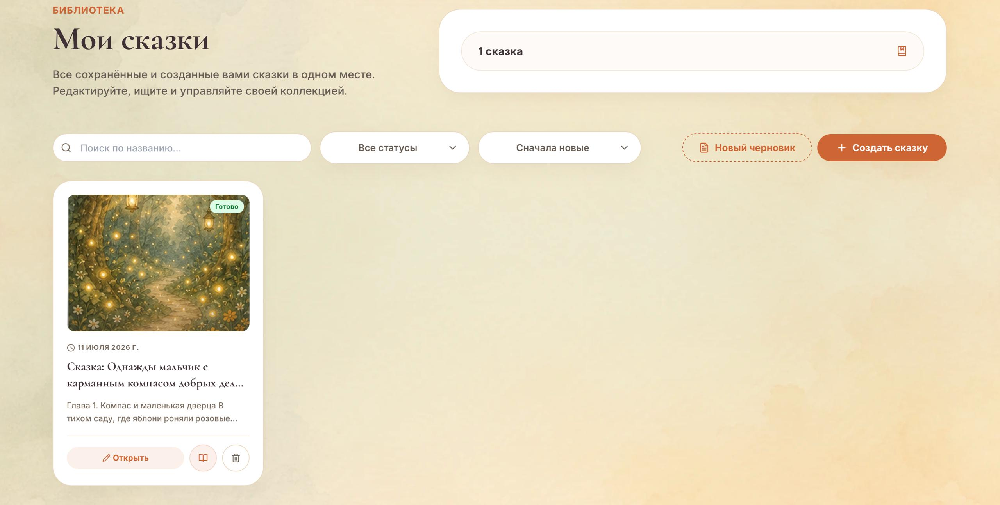
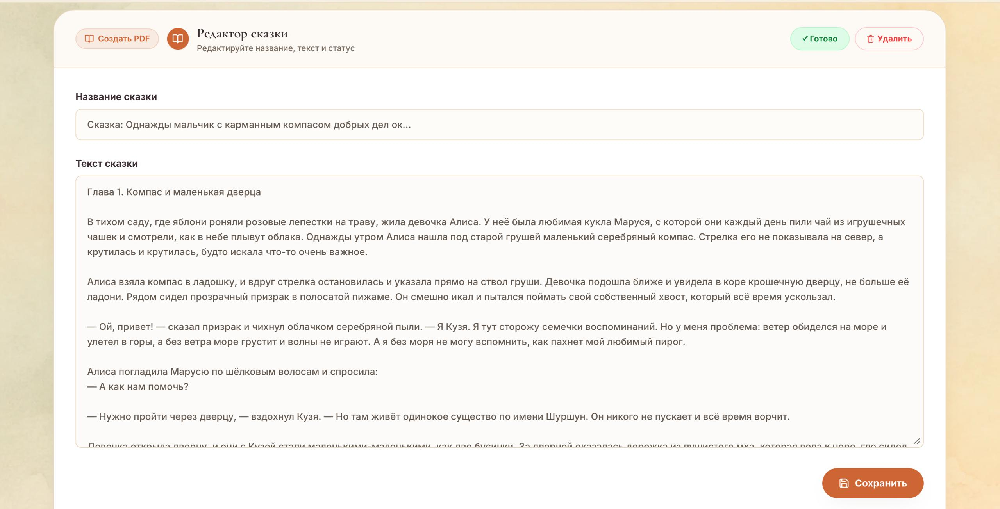

# ТвориСказку

**Персонализированные сказки и аудиоистории, которые родители создают для детей за несколько минут.**

ТвориСказку помогает родителям превратить простую идею в готовую детскую сказку: выбрать возрастную группу, жанр, героя, настроение и голос рассказчика, а затем сохранить историю в библиотеку, озвучить её и скачать MP3. Получается личная история, которую можно читать, слушать и возвращать в семейную коллекцию.



## Идея

У родителей часто есть желание придумать ребёнку сказку о нём самом: про любимого героя, привычную ситуацию, страх, мечту или маленькую победу. Но каждый вечер писать хорошую историю с нуля сложно.

ТвориСказку берёт на себя творческую и техническую часть. Родитель задаёт направление, выбирает настроение и голос, а сервис собирает добрую сказку, которую можно сохранить, перечитать, озвучить и включить ребёнку снова.

## Что делает сервис ценным

- **Понятный пользовательский сценарий.** От идеи до готовой аудиосказки путь проходит внутри одного интерфейса.
- **Эмоциональная ценность.** Истории обращаются к ребёнку по имени и звучат как личный подарок, а не как безличный текст.
- **Повторное использование.** Сказки сохраняются в библиотеке, редактируются и остаются доступными для прослушивания.
- **Голоса рассказчиков.** Родитель заранее выбирает тембр, который подходит конкретной истории: спокойный, загадочный, домашний или сказочный.
- **Детская безопасность.** Запросы и тексты проходят фильтры, чтобы в сказку не попадали неподходящие для детей или лишние чувствительные сведения.
- **Аккуратный визуальный язык.** Интерфейс выглядит мягко, цельно и семейно: как продукт, которому можно доверить вечерний детский сценарий.
- **Готовая основа для подписки.** Лимиты, аккаунт, библиотека, профили и озвучка уже собраны в понятную продуктовую модель.

## Как создаётся сказка

Пользователь начинает с простой идеи. Это может быть одна фраза: про замок, добрые звёзды, лесную тропинку, любимую игрушку или маленькое приключение. Сервис не требует сложного промпта: интерфейс помогает родителю думать не технически, а по-человечески.



Дальше история настраивается как редактор настроения: жанр, возрастная группа, количество глав, место действия, тон и озвучка. Это делает результат управляемым, но не перегружает пользователя.



## Персонализация без лишней сложности

В продукте есть детские профили: имя, возрастная группа, аватар, интересы и любимые темы. Родитель один раз описывает важные детали, а затем может быстро создавать новые истории с уже знакомым героем и подходящей подачей.



Такой подход делает сказки ближе к семье: история может учитывать любимые темы ребёнка, привычный возрастной уровень и выбранный образ, но интерфейс остаётся лёгким.

## Озвучка как часть продукта

Сказка становится не только текстом, но и аудиоисторией. В сервисе можно выбрать голос рассказчика, послушать демо и после генерации получить MP3. Это важно для реального семейного использования: аудиосказку можно включить перед сном, в дороге или сохранить как любимую историю.



После сохранения сказки озвучка доступна прямо в редакторе. Пользователь может сменить голос, запустить озвучивание и получить готовый аудиофайл.



## Библиотека и редактор

Созданные сказки не исчезают после генерации. Они попадают в личную библиотеку, где их можно открыть, отредактировать, продолжить использовать и оформить в PDF.



Редактор даёт контроль над итоговым материалом: можно поправить название, текст и статус сказки, а затем сохранить финальную версию.



## Пользовательский путь

1. Родитель создаёт аккаунт.
2. Добавляет профиль ребёнка или вводит имя прямо при создании.
3. Описывает идею сказки.
4. Выбирает жанр, возрастную группу, тон и голос.
5. Получает готовую историю.
6. Сохраняет её в библиотеку.
7. Озвучивает и скачивает MP3.
8. Возвращается к сказке позже: читает, редактирует или создаёт новую.

## Для кого

**Родители дошкольников и младших школьников.** Быстрые сказки перед сном, истории под настроение ребёнка, мягкие воспитательные сюжеты.

**Семьи с несколькими детьми.** Разные профили, разные интересы, отдельные истории под каждого ребёнка.

**Образовательные и семейные сценарии.** Персональная история к празднику, адаптация сложной темы через сказку, аудиоистории для дороги и отдыха.

## Коммерческий потенциал

ТвориСказку естественно развивается в семейную подписку. Родителю не нужно покупать сложный инструмент: он получает понятный результат, который хочется повторять. Чем больше в семье появляется сохранённых историй, профилей и любимых голосов, тем выше ценность личной библиотеки.

Дальнейшее развитие может идти через расширение голосов, тематические коллекции, сезонные наборы сказок, семейные профили, улучшенное оформление PDF и более глубокую персонализацию сценариев. Отдельное направление роста — печатные книги под заказ: персональная сказка с иллюстрациями, которую можно подарить или сохранить дома. Основа уже собрана вокруг регулярного, эмоционально понятного действия: создать ребёнку новую сказку.

## Архитектура

Проект разделён на frontend, backend, хранилище данных, файловое хранилище и отдельные доменные модули. Это позволяет развивать продукт без превращения кода в один большой сценарий.

```text
.
├── src/                    # React-приложение
│   ├── components/          # Переиспользуемые UI-компоненты
│   ├── pages/               # Основные экраны продукта
│   └── lib/                 # Клиентские утилиты
├── backend/                 # API и бизнес-логика
│   ├── prisma/              # Схема БД и миграции
│   └── src/
│       ├── config/          # Конфигурация окружения
│       ├── lib/             # Общие backend-утилиты
│       └── modules/         # Доменные модули
├── public/                  # Публичные ассеты
├── assets/                  # Визуальные материалы
└── screenshots/             # Скриншоты продукта
```

### Основной стек

- **Frontend:** React, Vite, Tailwind CSS.
- **Backend:** Fastify, TypeScript, Prisma.
- **Database:** PostgreSQL.
- **Cache and queues:** Redis.
- **File storage:** S3-совместимое хранилище.
- **PDF:** генерация книг на backend.
- **Tests:** Vitest.

### Проверки

```bash
npm test
npm run build
npm --prefix backend run test
npm --prefix backend run build
```

### Окружение

Шаблон переменных находится в `.env.example`. Реальные ключи и пароли должны храниться только в локальных `.env` файлах или в переменных окружения хостинга.
